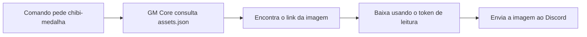
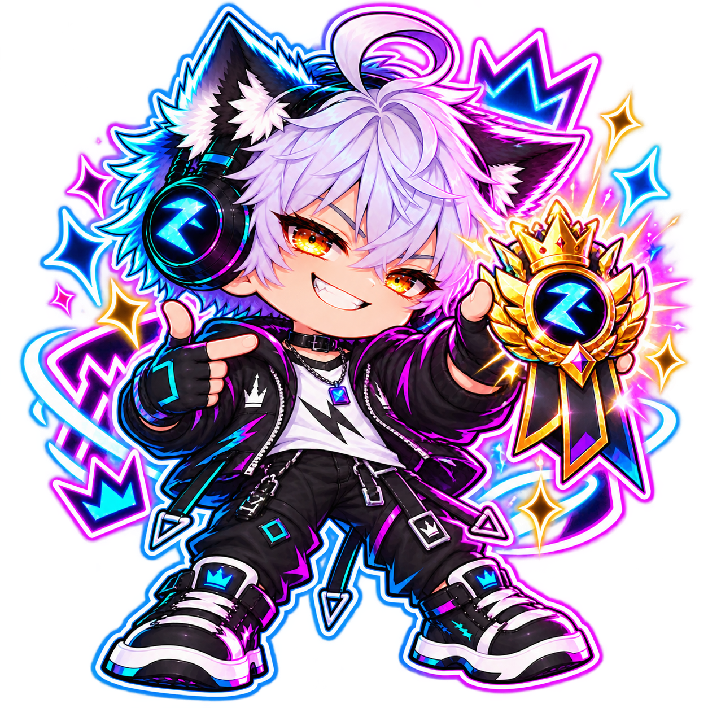
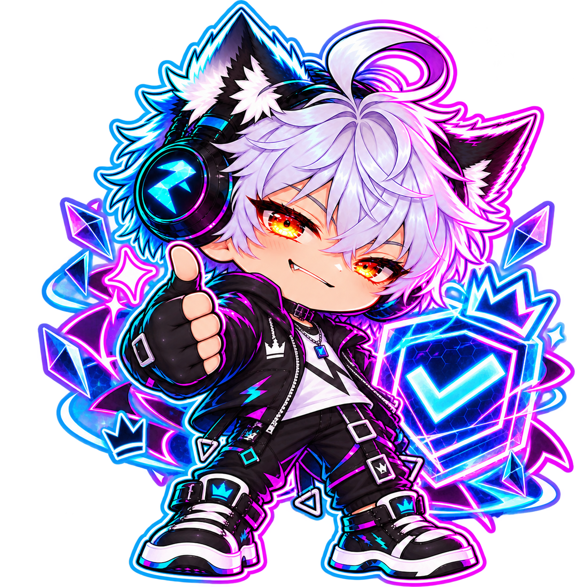
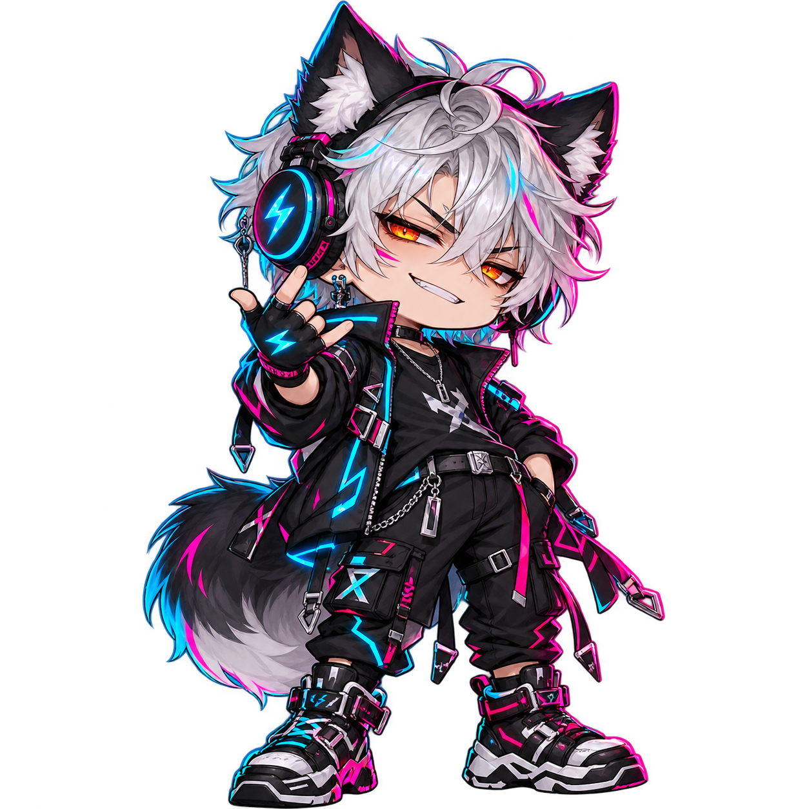

# GM Core Artes

Aqui ficam as imagens que o bot GM Core poderá usar no Discord. Você escolhe uma arte pelo nome, e o bot consulta o catálogo para descobrir onde baixá-la.

Este guia explica a biblioteca para você e também orienta o modelo que vai configurar seu uso no projeto principal.

## Como a ideia funciona

Imagine que você quer mandar a imagem de uma medalha. Em vez de espalhar o link dela pelo código, você usa o nome `chibi-medalha`.

O arquivo [`assets.json`](assets.json) funciona como uma agenda: você procura o nome da arte e encontra o arquivo e o link correspondente. O token de leitura funciona como a chave de acesso ao repositório privado.



| Peça | Para que serve | Onde fica |
|---|---|---|
| Imagens | São as artes que serão enviadas | Na pasta `assets/` deste repositório |
| `assets.json` | Relaciona nomes, arquivos e links | Na raiz deste repositório |
| Token de leitura | Permite ao bot acessar os arquivos privados | No ambiente ou `.env` do GM Core |
| Integração do bot | Procura a arte, baixa e envia | No projeto principal GM Core |

## Estado atual

O acervo contém **266 arquivos visuais**, todos catalogados em [`assets.json`](assets.json), versão 2. As imagens ficam exclusivamente em `assets/`. O código que usa a biblioteca pertence ao projeto GM Core.

**Publicação pendente:** ainda falta configurar o remoto e publicar o repositório privado. `SEU_USUARIO` e `SEU_REPOSITORIO` são placeholders nos links do catálogo; eles não são endereços utilizáveis. Antes de testar a integração, substitua-os pelo proprietário e nome reais em `repository` e em todas as URLs. Nenhum token deve entrar no JSON.

## Organização

```text
assets/
  backgrounds/   # planos de fundo
  banners/       # banners atuais
  chibi/         # personagens e reações separados por tema
  emotes/        # emotes
  figurinhas/    # figurinhas
  futuras/       # versões futuras, não selecionar automaticamente
  instagram/    # artes de redes sociais
  legacy/       # versões antigas, não selecionar automaticamente
  recortes/     # conjuntos para recorte
assets.json     # dicionário oficial de nomes, caminhos e links
README.md       # guia de consumo pelo GM Core
doc/            # planejamento, fluxograma e histórico do inventário
taks/           # pendências da publicação e integração
```

As subpastas de chibi preservam os temas e lotes existentes. `reacoes_lobo/` agrupa as variantes com orelhas e cauda. Nomes novos usam minúsculas e `_`, sem acentos, espaços, datas de download ou referências ao ChatGPT. Alguns arquivos antigos ainda têm UUIDs; os identificadores deles foram preservados até a revisão visual e escolha de nomes descritivos.

## Como ler o catálogo

O catálogo tem dois níveis de organização: primeiro a **categoria**, depois o **nome usado no código**, também chamado de chave ou identificador.

Por exemplo, a medalha está na categoria `chibi` e tem a chave `chibi-medalha`. Essa chave é diferente do nome do arquivo, que é `medalha.png`.

| Campo | Significado | Exemplo |
|---|---|---|
| `version` | Versão do formato do catálogo | `2` |
| `repository.owner` | Usuário ou organização dona do repositório | `SEU_USUARIO` por enquanto |
| `repository.name` | Nome do repositório no GitHub | `SEU_REPOSITORIO` por enquanto |
| `repository.visibility` | Visibilidade planejada do repositório | `private` |
| `repository.branch` | Branch de onde as imagens serão lidas | `main` |
| `asset_count` | Quantidade total de arquivos catalogados | `266` |
| `assets` | Dicionário que reúne todas as categorias | `chibi`, `banners`, `emotes`… |
| `chibi-medalha` | Chave para pedir a arte no código | Pode ser usada em uma função de envio |
| `name` | Nome do arquivo da imagem | `medalha.png` |
| `path` | Pasta e arquivo dentro do repositório | `assets/chibi/10_Premium/medalha.png` |
| `api_url` | Endereço usado pelo bot para baixar o arquivo | Link da API GitHub com autenticação |

Este é um recorte real do catálogo, incluindo o nível `assets`. Os dados do GitHub ainda estão por preencher:

```json
{
  "assets": {
    "chibi": {
      "chibi-medalha": {
        "name": "medalha.png",
        "path": "assets/chibi/10_Premium/medalha.png",
        "api_url": "https://api.github.com/repos/SEU_USUARIO/SEU_REPOSITORIO/contents/assets/chibi/10_Premium/medalha.png?ref=main"
      }
    }
  }
}
```

Para encontrar uma arte, abra o JSON e procure sua chave. No código, a consulta segue o mesmo caminho: `assets` → `chibi` → `chibi-medalha`.

Consulta no código do GM Core, depois que ele tiver carregado o catálogo:

```python
arte = catalogo["assets"]["chibi"]["chibi-medalha"]
link = arte["api_url"]
```

É possível oferecer no GM Core uma função `enviar_arte("chibi-medalha")` que procure essa chave nas categorias. O código dos comandos deve usar a chave, mantendo os links concentrados no catálogo. Não invente chaves: consulte as que existem no JSON.

Essa função é uma sugestão para a integração; ainda precisa ser implementada no projeto principal. O JSON sozinho não envia imagens.

## Catálogo por categoria

Você pode abrir os links das pastas abaixo para ver as imagens no GitHub. A contagem inclui variantes e cópias preservadas, não somente artes únicas.

| Categoria | Arquivos | O que você encontra |
|---|---:|---|
| [Planos de fundo](assets/backgrounds/) | 2 | Fundos e wallpapers |
| [Banners](assets/banners/) | 28 | Banners atuais |
| [Chibis](assets/chibi/) | 128 | Reações, moderação, gamer, premium e temas especiais |
| [Emotes](assets/emotes/) | 48 | Imagens para expressões e reações |
| [Figurinhas](assets/figurinhas/) | 8 | Figurinhas do acervo |
| [Versões futuras](assets/futuras/) | 9 | Artes reservadas para revisão e uso futuro |
| [Instagram](assets/instagram/) | 27 | Artes destinadas às redes sociais |
| [Artes antigas](assets/legacy/) | 12 | Histórico de versões antigas |
| [Recortes](assets/recortes/) | 4 | Conjuntos para recortar e preparar |
| **Total** | **266** | Todos os arquivos visuais do catálogo |

### Exemplos para reconhecer pelo nome

| Prévia | Nome para usar no código | Categoria |
|---|---|---|
|  | `chibi-medalha` | `chibi` |
|  | `chibi-aprovado` | `chibi` |
|  | `chibi-lobo-provocando` | `chibi` |

As prévias ajudam a reconhecer algumas artes; o catálogo completo continua sendo o `assets.json`.

## O que você precisa fazer antes de usar

1. **Publicar esta pasta no GitHub como repositório privado.** O Git local já foi iniciado, mas ainda não há remoto configurado.
2. **Preencher os dados reais no catálogo.** Substituir `SEU_USUARIO` e `SEU_REPOSITORIO` tanto no bloco `repository` quanto em todos os links `api_url`. Alterar só o bloco inicial não atualiza os links automaticamente.
3. **Criar um token de leitura.** Nas configurações da sua conta GitHub, criar um fine-grained Personal Access Token, selecionar somente este repositório e dar a permissão `Contents: Read-only`. A API do GitHub já existe; o que você gera é a credencial de acesso.
4. **Configurar o ambiente do GM Core.** Salvar o token e os dados do repositório nas variáveis mostradas abaixo. Na hospedagem, usar a área de variáveis de ambiente/secrets.
5. **Pedir ao modelo do projeto principal para implementar a integração.** Ele deve ler este README e o catálogo, configurar a busca por nome e testar um envio real ao Discord.

Um link com `SEU_USUARIO` ainda não aponta para seu acervo. Depois de preencher e publicar, ele apontará para o arquivo real, mas continuará exigindo autenticação por ser privado. Abrir a URL no navegador sem o token não é um teste suficiente de acesso do bot.

## Acesso privado no GM Core

Projeto consumidor local:

```text
C:\Users\vinic\Desktop\Vinicius Vicentim\Projects\GM Core
```

Configure estas variáveis no ambiente do GM Core ou no seu `.env` local ignorado pelo Git:

```env
GITHUB_ASSETS_OWNER=proprietario_real
GITHUB_ASSETS_REPOSITORY=repositorio_real
GITHUB_ASSETS_BRANCH=main
GITHUB_ASSETS_TOKEN=token_somente_no_ambiente
```

No `.env.example`, deixe o token vazio. Use um fine-grained PAT limitado a este repositório, com **Contents: Read-only**.

O GM Core deve buscar o catálogo em:

```text
https://api.github.com/repos/{owner}/{repository}/contents/assets.json?ref={branch}
```

Para obter diretamente os bytes do JSON e das imagens, faça requisições autenticadas à API com estes cabeçalhos:

```text
Authorization: Bearer <token lido do ambiente>
Accept: application/vnd.github.raw+json
```

Use o formato raw também para imagens maiores que 1 MB; a resposta padrão de metadados não entrega seu conteúdo inline nesses casos. Configure timeout e suporte a redirecionamentos no cliente HTTP. A permissão e o formato estão descritos na [documentação oficial do GitHub](https://docs.github.com/en/rest/repos/contents#get-repository-content).

## Roteiro para o modelo que implementar no GM Core

1. Ler este README e `assets.json`; ler também o `AGENTS.md` do projeto principal antes de alterá-lo.
2. Conferir se os placeholders foram substituídos, o repositório foi publicado e as variáveis estão configuradas. Se faltar configuração, reportar a pendência sem pedir o token no chat.
3. Usar as bibliotecas e os padrões já existentes no GM Core para baixar e interpretar o catálogo UTF-8, validando a versão 2 e seus campos.
4. Implementar resolução por chave, download autenticado e envio dos bytes ao Discord como anexo. Para usar em embed, referenciar o próprio anexo com `attachment://nome_do_arquivo.png`.
5. Não passar a URL privada diretamente ao Discord nem colocar o token no link, em mensagens ou em logs. Só enviar a credencial para endpoints HTTPS da API GitHub aprovados; não encaminhá-la indiscriminadamente em redirecionamentos para outro host.
6. Tratar chave ausente, credencial inválida, arquivo indisponível, timeout, rate limit e limites de tamanho do Discord. Evitar downloads repetidos quando o projeto já tiver uma estratégia de cache.
7. Testar pelo menos uma imagem real, uma chave inexistente e uma falha de acesso. Selecionar explicitamente itens de `futuras` ou `legacy` apenas quando solicitado.

O repositório de artes continua sendo estático. Toda implementação deve ser feita no projeto principal.

## Manutenção e referências

Para adicionar uma arte, coloque a imagem na categoria correta em `assets/` e acrescente sua entrada no JSON com uma chave única, nome, caminho e link. Atualize também `asset_count` e a contagem deste README se o total mudar. O catálogo é estático: colocar o arquivo na pasta não cria a entrada automaticamente.

Para renomear ou mover um arquivo já usado, atualize `name`, `path` e `api_url` no mesmo commit. Mantenha a chave estável para os comandos existentes continuarem encontrando a arte. Só mude a chave se também ajustar os consumidores no GM Core.

Salve o JSON como UTF-8. Ele não aceita comentários nem vírgula depois do último item. Preserve variantes e cópias até decidir qual será a versão oficial.

### Pedido pronto para enviar ao modelo do GM Core

> Leia o README da raiz e o assets.json do repositório GM Core Artes. No projeto principal GM Core, siga o AGENTS.md e implemente a integração com essa biblioteca privada. Use as variáveis GITHUB_ASSETS_OWNER, GITHUB_ASSETS_REPOSITORY, GITHUB_ASSETS_BRANCH e GITHUB_ASSETS_TOKEN. Os comandos devem pedir a imagem pela chave do catálogo, por exemplo chibi-medalha. Baixe o catálogo e as imagens com autenticação e envie as imagens como anexos ao Discord. Confira a configuração pendente antes de testar e nunca exponha o token. Use o roteiro técnico deste README e as bibliotecas já existentes no projeto.

- [Planejamento](doc/README.md)
- [Fluxograma](doc/fluxograma.md)
- [Tarefas](taks/README.md)
- [Renomeações recentes](doc/renomeacoes.md)
